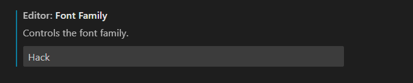

# Config
configuration files for various things:
- bashrc: bash config 
- zshrc: zshell config
- minttyrc: bash for windows
- vimrc: simple VIM config
- bash_aliases: commandline aliases
- tmux.conf: Tmux config for easy window hopping


## 1. Git config:
Git lg From https://coderwall.com/p/euwpig/a-better-git-log:


```bash
git config --global alias.lg "log --graph --pretty=format:'%Cred%h%Creset -%C(yellow)%d%Creset %s %Cgreen(%cr) %C(bold blue)<%an>%Creset' --abbrev-commit --date=relative"
```

## 2. Z for easy folder hopping
Install "z.sh" by copying the file somewhere in home and add it to the bashrc:

```bash
. ~/z.sh
```

## 3. Programming font
I like the [hack font](https://github.com/source-foundry/Hack) for programming because of the clear distinction of `lIi|` and `oO0Q`.


Configure VSCode (`Ctrl + ,`):




## 4. Setting up a pretty bash terminal
Change the bashrc to whatever is in there. Pay special attention to the section of code below. It will make the terminal look similar to the one in the zsh section, without the zsh + theme install.


```bash
PROMPT_DIRTRIM=3

git_prompt() {
    local branch dirty=""

    git rev-parse --is-inside-work-tree >/dev/null 2>&1 || return

    branch=$(git symbolic-ref --quiet --short HEAD 2>/dev/null) ||
        branch=$(git rev-parse --short HEAD 2>/dev/null)

    # Only tracked/staged changes; ignore untracked files
    if ! git diff --quiet --ignore-submodules -- 2>/dev/null ||
       ! git diff --cached --quiet --ignore-submodules -- 2>/dev/null; then
        dirty="*"
    fi

    if [ -n "$dirty" ]; then
        printf ' \e[38;5;244mgit:\e[38;5;214m%s\e[38;5;196m*\e[0m' "$branch"
    else
        printf ' \e[38;5;244mgit:\e[38;5;214m%s\e[0m' "$branch"
    fi
}

if [ "$color_prompt" = yes ]; then
    PS1='\[\033[38;5;45m\]╭─\[\033[0m\]\[\033[97m\][\[\033[38;5;39m\]${CONDA_DEFAULT_ENV:-base}\[\033[97m\]]\[\033[0m\] \[\033[01;32m\]\u@\h\[\033[0m\] \[\033[38;5;244m\]in\[\033[0m\] \[\033[01;34m\]\w\[\033[0m\]$(git_prompt)\n\[\033[38;5;45m\]╰─❯\[\033[0m\] '
else
    PS1='╭─[${CONDA_DEFAULT_ENV:-base}] \u@\h in \w$(git_prompt)\n╰─❯ '
fi
```


